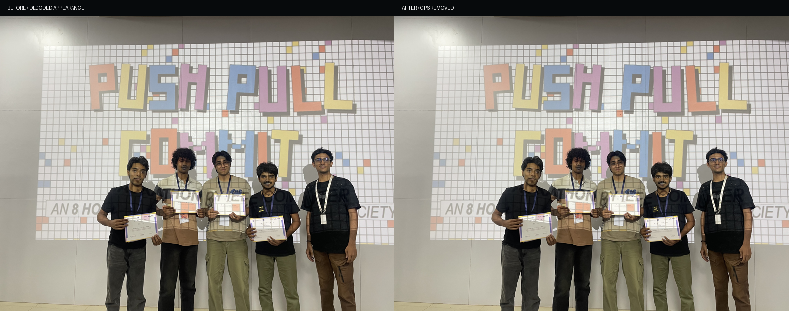

# Project integrity remediation — F07, F08 and F11

**Review date:** 26 October 2026, India time. **Starting revision:** `77eee63`. **Build:** Next.js 16.4.3, webpack.

References: [production audit](PORTFOLIO_PRODUCTION_AUDIT.md), [F02](ACCESSIBILITY_F02_REMEDIATION.md), [F03/F04](F03_F04_REMEDIATION.md), [F05](F05_ACCESSIBILITY_POLISH.md), and [SEO/branding](SEO_BRANDING_REMEDIATION.md).

The existing uncommitted SEO work was present at the start and is preserved. This agent did not reset history, discard other work, commit or deploy. Application corrections are limited to project actions, evidence qualifications, two availability styles and GPS metadata in the two affected photo copies. No new demo/repository destination or project version was published.

## 1. Complete CTA inventory

The pre-change rendered Work section contained **eight anchors**. Two led only to “coming soon”; six were useful, unique destinations. The post-change Work section contains those **six original functioning anchors**. Image-linked certificate captions describe their image action; they are not additional controls. The Work coordinate rail and handoff geometry are decorative, not project buttons.

| Project | Original label / accessible name | Original destination | Type and observed behavior | Recommended correction / action taken |
| --- | --- | --- | --- | --- |
| SatQuery AI | LIVE SYSTEM; “Open the live SatQuery AI system in a new tab” | `https://sat-query-ai-phi.vercel.app/` | External application entry; fresh browser GET 200, SatQuery AI title and matching geospatial landing | Keep unchanged. Landing availability is verified; inference/accuracy was not exercised. |
| Gesture Globe | LIVE EXPERIENCE; “Open the live Gesture Globe experience in a new tab” | `https://gestureglobe.vercel.app/` | External application entry; 200, matching title, camera-permission explanation | Keep unchanged. Camera was not granted; permission denial is not a broken-link finding or a successful gesture test. |
| AlgaeOS | VIEW ORIGINAL INFOGRAPHIC; image plus text | `/projects/algaeos/algaeos-system-infographic.jpg` | Public project-record image; 200, decodable 572×1024 image | Keep original evidence action. The infographic is a project record, not independent measurement verification. |
| AlgaeOS | EXPLORE ALGAEOS | `#algaeos-detail` | Fragment exists but contains only “Full AlgaeOS case study coming soon.” | Remove misleading anchor. Replace with plain **CASE STUDY NOT PUBLISHED** text. |
| Dayflow | LIVE APP; “Open the live Dayflow application in a new tab” | `https://dayflow-anirudh6.vercel.app` | External app entry; redirects to `/login`, final 200, matching Dayflow sign-in UI | Keep unchanged. No account, authentication or database policy test was performed. |
| MediTwin | Certificate image; “View the full MediTwin first-place certificate in a new tab” | `/projects/meditwin/incseption-2-certificate.jpg` | Original evidence image; 200, decodable 3128×2173 certificate | Keep unchanged; first-place document remains available once. |
| MediTwin | VIEW MEDITWIN | `#meditwin-detail` | Fragment exists but contains only “Full MediTwin case study coming soon.” | Remove misleading anchor. Replace with plain **CASE STUDY NOT PUBLISHED** text. |
| MediFit | Certificate image; “View the full MediFit third-place certificate in a new tab” | `/projects/medifit/push-pull-commit-certificate.jpg` | Original evidence image; 200, decodable 1458×1031 certificate | Keep unchanged; third-place document remains available once. |
| MediFit | LIVE DEMO UNVERIFIED | None; already a paragraph after F03 | Informational status, not a link/button or focus target | Preserve the F03 correction. Do not restore the mismatching live-app destination. |

The two About **Inspect the original** actions retain their original school-award and Google-certificate image destinations. Work reading mode, About reader switching, primary navigation, Contact and Back to Top are retained and covered by their existing suites.

Evidence: [before inventory and public page responses](qa/project-integrity/before/content-inventory.json), [after inventory](qa/project-integrity/after/content-inventory.json), and [focused content checks](qa/project-integrity/after/content-review.json). No new project action duplicates an evidence URL. No repository link was substituted merely because a repository name looked plausible.

## 2. Verified destinations and their limits

Fresh read-only browser visits on the review date confirm the three existing public entries above. [SatQuery AI](https://sat-query-ai-phi.vercel.app/) presents the matching product, [Gesture Globe](https://gestureglobe.vercel.app/) reaches its camera-permission state, and [Dayflow](https://dayflow-anirudh6.vercel.app/login) presents the expected two-portal sign-in UI. No credentials, API keys, camera permission, account creation or authenticated workflow were requested or used.

The three retained Work evidence images return 200 from the local production server. Native Tab/Enter certificate activation and loaded image dimensions remain checked by F02/F03. “Available” here means the observed entry/evidence loads; it does not certify backend inference, gesture latency, clinical usefulness or authenticated HR behavior.

Public repository records were inspected read-only at explicit revisions:

| Repository | Inspected revision | What it supports / limit |
| --- | --- | --- |
| [SatQuery-AI](https://github.com/AnirudhShashikumar/SatQuery-AI/tree/bc0bc5845606905f22d675a75c23ce68a1b65624) | `bc0bc5845606905f22d675a75c23ce68a1b65624` | Matching project context and saved benchmark report. It is project evidence, not an independent rerun. |
| [Dayflow](https://github.com/AnirudhShashikumar/Dayflow/tree/165d11c10b3af553b5b7df52fa24e72b64674b26) | `165d11c10b3af553b5b7df52fa24e72b64674b26` | Architecture and historical README claims. Its dated 13 September source audit explicitly excludes live Supabase/deployment verification; it is not a dated successful 68-test run. |
| [gesture-globe](https://github.com/AnirudhShashikumar/gesture-globe/tree/c35f980b51ede328f8d4055314b101b355bf1e89) | `c35f980b51ede328f8d4055314b101b355bf1e89` | Matching implementation/documentation context; no independent camera/FPS run. |
| [MediFit](https://github.com/AnirudhShashikumar/MediFit/tree/bac6c1fdfc387a96d0d17f0fdbf74d5c0fef1c7a) | `bac6c1fdfc387a96d0d17f0fdbf74d5c0fef1c7a` | Root documentation describes fitness; other available product evidence differs. This does not resolve the historical deployment/version relationship. |
| [TwinFit](https://github.com/AnirudhShashikumar/TwinFit/tree/6ab5380df2b50061ed0814ec37afc9ad071ef0c6) | `6ab5380df2b50061ed0814ec37afc9ad071ef0c6` | No verified mapping to the featured MediTwin narrative was established. Not published as a replacement action. |

See [source inventories and snapshots](qa/project-integrity/before/project-records/). Neither an existing README nor repeated portfolio prose is counted as independent corroboration.

The organizer's [GDG InCSEption 2.0 event page](https://gdg.community.dev/events/details/google-gdg-on-campus-bms-institute-of-technology-management-bengaluru-india-presents-incseption-20/) independently confirms an event at BMSIT&M on 6 April 2026. It does not supply the ~130-team field count or this project's result; those cannot be inferred from an RSVP counter. Scoped organizer/college searches did not establish the other outstanding field/shortlist records. This is a search limit, not proof that the records do not exist.

## 3. Removed or corrected placeholders

- AlgaeOS and MediTwin endcap anchors are now paragraphs: **CASE STUDY NOT PUBLISHED**. They have no destination, action arrow, button border/hover behavior, link/button role, disabled-control imitation or tabindex.
- The existing `data-mt-cta` target remains on the MediTwin paragraph, preserving its existing motion sequence. No GSAP target or animation was removed to fix the content issue.
- All six “Full … case study coming soon” statements now say **“No separate … case study is published.”** No future delivery promise or fictional case-study page remains. Existing detail fragment IDs and layout containers remain compatible with old bookmarks, but no project action leads to those availability notes.
- The original AlgaeOS infographic and both healthcare certificate links remain their projects' single evidence action. A second link to the same evidence was not created to fill the empty endcap.

## 4. Claim-evidence matrix

The **complete 42-entry matrix** records exact original wording, starting source line, available evidence and its limits, classification, recommended wording and action: [CSV](qa/project-integrity/claim-evidence.csv), [JSON](qa/project-integrity/claim-evidence.json). Source-line references describe the starting snapshot/revision, before the wording edits.

“Verified” means the stated fact is visible in the inspected document or directly observed response. It does not authenticate a document cryptographically or extend its scope to unrelated project behavior. “Supported by project records” identifies actual project artifacts; it is stronger than repeated prose but remains distinct from an independent rerun. No claim was labeled “outdated” solely because it lacked a date.

| Claim group | Evidence classification | Resolution / limits |
| --- | --- | --- |
| SatQuery single-image, optical/SAR and bi-temporal model routes | Supported by matching project records and public interface | Retained as system architecture; live inference/correctness not tested. |
| RSVQA 71.05% exact, 74.31% overflow-aware, 10,004 questions | Supported by saved model/checkpoint/test records | Actual saved totals are 7,108 exact and 7,434 overflow-aware answers of 10,004. Snapshot qualification added; no new evaluation invented. |
| Grounding 0.2348 mean IoU, 25.05% at IoU 0.50, 16,146 samples | Supported by saved project validation record | Stored values round to those claims; model/split scope retained, no independent rerun or live-system guarantee. |
| Gesture real-time interaction and screenshots | Project implementation/captures support design; actual camera/latency run unverified | Still-image wording now says the captures illustrate pinch/scale, rather than proving a working real-time system. No numerical FPS claim added. |
| AlgaeOS >40%, ~1500→<900ppm, within hours | Owner/project-reported observations | Existing explicit non-certified, project-reported caveats retained. No raw calibration/log/control record was supplied. The infographic's repetition is not independent proof. |
| AlgaeOS <₹2,500, one semester, team of four, 10/10 credits | Owner/project-reported | Local cost, timeline/team and academic-outcome labels now make that attribution explicit. Receipts/course records still needed for stronger verification. |
| Dayflow architecture and role-aware workspaces | Supported by source/design records and login/captures | Architecture retained. Deployed authorization is explicitly not independently verified here. |
| Dayflow 68 passing / typecheck / lint / build / current smoke assertions | Unverified as current; potentially misleading presentation | Precise count, checkmarks and current PASS claims removed. Historical project-note attribution and not-re-run status replace them. Portfolio test results are not substituted for Dayflow test results. |
| MediTwin first place / eight-hour event | Verified certificate content | Certificate names Code Blue, first place and an eight-hour hackathon. Product association and actual team execution history remain the project account. |
| MediTwin ~130 teams / four members / build account | Owner/project-reported; event photograph provides context | Field, role and execution prose qualified. No organizer count or formal roster inferred from a certificate/photo. |
| MediFit third place / event / date / organizer | Verified certificate content | Ranking and certificate link retained. The certificate does not name the product or print an eight-hour duration. |
| MediFit eight-hour build, four members, 50+ teams | Project-reported build/roster/field | Event photograph advertises an eight-hour hackathon, but does not time the team's build or establish total field size. Qualifiers added at each statistic/repeated result and timeline. |
| MediFit full-stack functionality and healthcare personalization | Historical project account; exact live version remains unresolved | Existing narrative attributed; no replacement version selected, no clinical validation or matching live demo claimed. F03 status retained. |
| School HTML award, first position, 2020 | Verified supplied certificate content | Certificate visibly includes first position, HTML competition and 02/12/2020. Specific origin/implementation details remain personal recollection. Award preserved. |
| Google AI Professional Certificate, seven courses, 2026 | Verified supplied certificate content | Image includes name, seven courses and 7 August 2026. No completed degree/employment inferred; live issuer-registry authentication is not claimed. |
| SIH college shortlist for project submission | Owner-reported; college record pending | **REPORTED COLLEGE SHORTLIST FOR PROJECT SUBMISSION** preserves the complete limited claim. No national finalist/award implied. |
| Basketball school first / PUC football second | Personal account | Both results now explicitly say **(PERSONAL ACCOUNT)**. Unrelated HTML/coding certificates are not used to corroborate sports. |
| Student identity, learning, architecture/workflow and contribution accounts | First-person biography / project records where available | Retained without inventing completed degrees, employers, professional credentials or independently certified skill. |

The benchmark evidence is a limited summary/hash of the actual existing local records, not newly produced test output: [local benchmark evidence](qa/project-integrity/before/local-benchmark-evidence.json). The [public RSVQA benchmark report](https://github.com/AnirudhShashikumar/SatQuery-AI/blob/bc0bc5845606905f22d675a75c23ce68a1b65624/sar-colorization-app/artifacts/rsvqa_full_specialist_v1/benchmark_report.md) supplies corresponding model, checkpoint, split and limitations. The measurements are not generalized to other models, physical object counts or the currently deployed application.

## 5. Exact wording changes

| Location | Before | After |
| --- | --- | --- |
| Two empty endcap actions | EXPLORE ALGAEOS / VIEW MEDITWIN | CASE STUDY NOT PUBLISHED; paragraphs, not links |
| Six detail notes | Full [project] case study coming soon. | No separate [project] case study is published. |
| AlgaeOS metrics/endcap | PROTOTYPE COST; BMSIT · 1 SEMESTER · TEAM OF 4; ACADEMIC OUTCOME | REPORTED PROTOTYPE COST; PROJECT ACCOUNT / …; REPORTED ACADEMIC OUTCOME |
| MediTwin role/field/execution | TEAM PROJECT / …; FIELD; A four-person team shaped… | PROJECT ACCOUNT / …; REPORTED FIELD; In the team's account, four members shaped… |
| Dayflow heading | VERIFIED. STILL EVOLVING. | REPORTED. NOT RE-RUN. |
| Dayflow verification paragraph | Repository checks … redirects pass. | Project notes report automated checks. Dated test output and a source revision are not linked here; these are not current verification results. |
| Dayflow result cells | ✓ 68 PASSING / ✓ PASSING | — NO RUN LINKED / — NOT RE-RUN |
| Dayflow authorization paragraph | Server checks and RLS protect the underlying data. | Design/policy description followed by deployed authorization not independently verified here. |
| MediFit role/statistics/repetitions | TEAM PROJECT; BUILD WINDOW; FIELD; TEAM; repeated unqualified counts | PROJECT ACCOUNT; REPORTED WINDOW/FIELD/TEAM; REPORTED prefixes on repeated figures |
| MediFit contribution and execution | Worked across …; A four-person team … during the eight-hour hackathon | In the historical project account, work spanned …; In the team's account … during a reported eight-hour build |
| MediFit build label/result | BUILD CONSTRAINT; DELIVERED | REPORTED BUILD WINDOW; PROTOTYPE REPORTED |
| MediFit certificate alt | Includes an eight-hour duration not printed on this certificate | Describes Anirudh, Third Place, 4 May 2026 and the printed organizer |
| Last Work handoff caption | PERSONALIZED FITNESS / WORKING BUILD | PERSONALIZED FITNESS / PROJECT ACCOUNT |
| About SIH / sports | Unattributed limited shortlist and sports results | REPORTED college shortlist; (PERSONAL ACCOUNT) sports results |
| Gesture screen-reader description | Images show the working real-time system | Supplied captures illustrate the project's pinch and scale interactions |
| README benchmark metric | overall-aware accuracy | overflow-aware accuracy; original numerical result retained |
| README current-looking status/history | 68 tests / PASS and broad accessibility/performance ticks | Historical/not-re-run/project-account statements and scoped remediation/follow-up status |

The source-only [task patch](qa/project-integrity/after/task-source.patch) provides every exact textual change. It intentionally excludes binary image diffs, avoiding a new report artifact containing removed metadata. The two asset changes are instead evidenced by hashes and preservation results below.

## 6. Owner decisions and records still required

The owner said supporting records or links can be provided. A follow-up requested the links/local paths and which claim each supports. **The historical claims remain qualified until the actual records are supplied and inspected.** The offer itself is not treated as evidence that independently verifies the figures.

Records sought: AlgaeOS academic credits/cost and course/team context; MediTwin organizer field count/roster; MediFit field/roster and timed-build record; SatQuery's college shortlist. Sporting records may also strengthen the explicitly personal-account results. A dated Dayflow success log must identify its source revision before a precise test count or current PASS badge can be restored.

No owner decision was required to remove the misleading links, qualify claims or sanitize the confirmed GPS fields: those corrections were explicitly authorized. A future change to the featured healthcare project version, restored live demo, or replacement primary external destination still requires owner approval and verification. Neither the MediFit root README nor an unmapped TwinFit repository resolves that decision automatically. No API key or private credential is needed for this review.

## 7. GPS metadata inspection results

The scan inspected **all 21 public JPEG/PNG/HEIC image files**, including the otherwise unused but publicly addressable HEIC original. ExifTool 13.59 found GPS IFD fields in exactly two files:

| Public source copy | Before | After |
| --- | --- | --- |
| `public/projects/medifit/push-pull-commit-team-event.jpg` | 15 GPS IFD fields | 0 GPS/location fields |
| `public/projects/medifit/push-pull-commit-team-award-original.heic` | 15 GPS IFD fields | 0 GPS/location fields |
| Other 19 scanned public images | No GPS/location fields found | Unchanged, no GPS/location fields found |

The removed group included coordinate, altitude, direction, speed and GPS date/time tags. **No coordinate values, original EXIF blobs or GPS-bearing before copies were written to this report, QA logs or console.** Scan evidence contains tag names and counts only. Before/after appearance PNGs were decoded and saved with the color profile but without EXIF. Native HEIC decode intermediates were temporary and removed.

ExifTool was downloaded from its official release repository into a temporary tools directory, not installed as an application dependency. The operation deletes GPS/location tags only, without a public `_original` backup. It does not use blanket `-all=` removal. The [ExifTool FAQ](https://exiftool.org/faq.html) describes metadata editing as image-data lossless while cautioning that color-related metadata matters; the preservation checks here verify those properties directly.

Reproducible safe inspection/sanitization/served checks: [privacy.py](qa/project-integrity/privacy.py). Evidence: [before names/counts](qa/project-integrity/before/privacy-scan.json), [after scan](qa/project-integrity/after/privacy-scan.json), [local production responses](qa/project-integrity/after/served-privacy.json).

## 8. Asset preservation evidence

Both copies remain **4032×3024**, Orientation **1**, with the same **Display P3** profile. Each copy's compressed `ImageDataHash`, fully decoded RGB SHA-256 and raw ICC profile SHA-256 match its own before state exactly. Neither published source was decoded/re-encoded for the edit; native HEIC decoding was used only for independent appearance comparison.

The JPEG changes from **3,379,343 to 3,379,024 bytes**; the HEIC changes from **2,275,823 to 2,275,505 bytes**. File hashes and image/pixel/profile hashes are recorded in [before preservation](qa/project-integrity/before/asset-preservation.json) and [after preservation](qa/project-integrity/after/asset-preservation.json). GPS removal reduces the files slightly without quality loss. Unrelated images are byte-identical to the starting snapshot.

The [HEIC comparison](qa/project-integrity/after/push-pull-commit-team-award-original-comparison.png) also has identical before/after appearance pixels. See [comparison assertions](qa/project-integrity/after/appearance-comparison.json). This preserves visible event/venue content; removing location metadata does not anonymize what the photograph itself shows.

**Deployment distinction:** both sanitized local production originals return 200, have no location fields and match the cleaned filesystem hashes. A separate read-only check of the confirmed public deployment still returns the old JPEG and HEIC with **15 GPS fields each**. See [public deployment result](qa/project-integrity/after/public-deployment-readonly.json). This task does not falsely claim that an undeployed patch has removed the live exposure.

## 9. Accessibility regression results

The existing seven-case F02 suite passes after replacing its two obsolete placeholder-action expectations with the retained AlgaeOS infographic and MediTwin certificate. All six project headings and meaningful content remain in the actual Chrome accessibility tree. The six retained Work links are unique and usable; new statuses are ordinary paragraphs with no interactive role or tabindex.

Native Tab/Shift+Tab, visible focus, Contact Enter → Tab → email, Work reading cycles, cold/live reduced motion and no-JavaScript desktop/phone/short-height baselines pass. The forward sequence now contains **18 stops rather than 20**, reflecting exactly the two removed placeholder links. Contact retains exactly three anchors; no duplicate evidence or Contact focus target was created.

The F03/F04 suite retains certificate keyboard activation, LIVE DEMO UNVERIFIED status and footer contrast/layout assertions. Its isolated runner compares the entire MediFit narrative against the explicitly reviewed F08 wording, rather than requiring this task to preserve the old unqualified prose. Historical F03/F04 evidence/scripts were not rewritten.

Initial and Work-reading axe scans have zero rule violations in the F02 checks. Existing decorative/transitional contrast and layered-graphic manual-review limitations documented in F05 remain; no ARIA suppression was added. Browser AX/keyboard coverage is not real VoiceOver/NVDA/JAWS speech-output certification.

## 10. Cinematic and validation results

| Check | Result |
| --- | --- |
| `npx eslint src/` | Pass |
| `npx tsc --noEmit` | Pass |
| `npm run build:webpack` | Pass; Next.js 16.4.3 production output |
| `git diff --check` | Pass |
| Existing About content suite | 4/4 pass, including complete production no-JavaScript biography |
| Existing About motion suite | Pass; 20 holds, 76 transition/boundary samples, 65 viewport samples, reader focus, reverse and cleanup cases |
| Existing ScrollDiscovery suite | 7 viewports / 25 behavior cases pass |
| Existing F02 suite | 7 cases pass; all six project actions and Contact keyboard/AX behavior preserved |
| Existing F03/F04 suite | 7 cases pass with the reviewed wording expectation; certificate/status/footer checks preserved |
| Existing F05 inspection | 319 Hero states across 11 sizes have zero clips; twenty Dayflow labels across 16 states / 320 samples retain their 0.75 opacity floor; reading/reduced scans pass |
| Existing SEO/branding suite | 19 cases pass: all prior metadata, icons, crawl routes, Person data and 404 behavior |
| Existing production Chrome matrix | 8 viewports / 801 states; no errors, failed requests, broken loaded images, horizontal text/document overflow or active scrub mismatches |
| Existing production WebKit matrix | 3 viewports / 318 states; same zero-error/overflow/mismatch result |
| Existing supplementary production audit | Six reverse signatures match; WebGL fallback resolves; WebKit direct anchors, reader and reduced motion pass |
| Existing isolated Lenis input trials | All 9 regions / 108 states pass slow, fast and reverse input |
| Focused action inventory | Exactly 6 unique retained project anchors; 2 new statuses are plain paragraphs; no coming-soon action remains |
| Focused changed-text review | 8 viewport sizes pass actual text-bound checks in Work reading mode |
| Safe metadata and served-asset verification | All 21 current public images scan clear; both local production originals return 200 and match sanitized hashes |

Chrome matrix sizes: **360×800, 390×844, 430×932, 768×1024, 1280×720, 1280×800, 1440×900, 1728×1117**. WebKit: **390×844, 1280×720, 1440×900**. F05 additionally samples 391px, 600px and 767px intermediate Hero widths. This is installed Chrome 155.0.8059.85 and Playwright WebKit 26.5 automation on macOS arm64, not physical-device certification.

Across **1,119 matrix states**, trigger-count sets and About cinematic/editorial modes match the preceding SEO/F05 baseline. The sampler combines nearby points within 40px; the 1728px Chrome run contains one fewer coalesced sample. All nine regions and five Work handoffs remain. No section/animation was removed to achieve a pass.

Copy qualification causes expected line wrapping: sampled document-height changes range from approximately **0 to 148px**, with the larger increases on narrow phones. These are disclosed rather than described as pixel-identical layouts. The eight-size focused review confirms the changed text fits without hiding characters. The original typography/font settings are preserved; all **11 emitted WOFF2 files are byte-identical**. See [matrix comparison](qa/project-integrity/after/browser-comparison.json), [text bounds and screenshots](qa/project-integrity/after/content-review.json), [font comparison](qa/project-integrity/after/font-comparison.json), and [input results](qa/project-integrity/after/scroll-input.json).

All Hero, six project motion modules, `WorkNavigation.tsx`, About choreography, ScrollMotion, SmoothScroll/Lenis and ScrollDiscovery sources are unchanged. The one Work handoff caption and About evidence strings change content only; normalized plate ranges, scroll triggers, ownership, easing, transitions and reduced-motion conditions are preserved. New availability paragraphs retain the previous GSAP selector targets. No performance improvement, new model benchmark or independently re-run Dayflow check is claimed.

**Source preservation:** 14 of 113 starting source/asset/script files changed; the other **99** match their starting hashes. The 14 are the six project feature files, AlgaeOS/MediTwin availability CSS, `Work.tsx` caption, About content model, README, F02 action expectations and two GPS-bearing images. Existing SEO application/assets, dependency manifests/lockfile, framework/ESLint configuration, build scripts, focus architecture, footer fixes and cinematic implementations are preserved. See [source preservation](qa/project-integrity/after/source-preservation.json), [starting Git state](qa/project-integrity/before/git-status.txt), and [source-only patch](qa/project-integrity/after/task-source.patch).

Existing suites used isolated temporary runners for output directories; F03 additionally used the explicit reviewed narrative fixture. The original historical QA folders were not overwritten. Temporary runners were removed after validation; their complete [runner adaptations](qa/project-integrity/after/runner-adaptations.patch) remain reviewable. See the [QA index](qa/project-integrity/README.md) for evidence and reproduction notes. New safe inspection/evidence scripts remain in this task's QA folder for review. Existing Node module-type, external-lockfile and Three.Clock notices are retained as unrelated; no new hydration or missing-GSAP-target failure was recorded.

## 11. Remaining release conditions

1. **Public GPS exposure remains until authorized deployment.** Deploy the sanitized JPEG and HEIC together and verify fresh public responses/CDN copies. This agent did not deploy, purge caches or rewrite Git history. Historical copies are outside the current-file cleanup.
2. **Historical evidence strengthening remains open.** The owner offered supporting records; verify their contents before promoting qualified counts/academic/shortlist claims or publishing new destinations. Do not treat project prose or the offer of records as independent verification.
3. **Dayflow is not production-certified by portfolio checks.** Restoring current PASS results requires a dated project run tied to its revision; deployed authorization/authenticated workflows need separate evidence.
4. **Healthcare version mapping remains unresolved.** Preserve F03's current conservative presentation until a matching approved version/demo is verified. Certificate/event evidence alone does not establish clinical performance or product-version identity.
5. Earlier reports' real assistive-technology, physical-device, transitional/manual contrast and performance follow-ups remain subject to release acceptance. This task does not claim whole-site WCAG or unrestricted release certification.

## 12. F07 / F08 / F11 closure verdicts

| Finding | Verdict |
| --- | --- |
| **F07 — misleading project actions** | **Closed in the tested local production build.** Two placeholder anchors removed; six useful, verified entry/evidence destinations retained; honest availability notes replace future promises. No alternative project version/URL invented. |
| **F08 — unsupported/current-looking claims** | **Presentation corrected; historical evidence verification remains open.** Current-looking Dayflow results and unsupported precision removed, saved benchmark records identified, metric label corrected, and incomplete historical claims explicitly attributed. Awards remain. Owner-provided records are still needed before the outstanding figures can be independently verified. |
| **F11 — GPS metadata** | **Current source files and local production responses remediated. Public deployment closure pending.** Both affected copies sanitized with exact image/pixel/profile preservation; all 21 current public images scan clear. The unchanged live copies still expose GPS until deployment. |

These verdicts distinguish verified corrections from evidence and deployment work that has not happened. No commit or deployment was performed.
