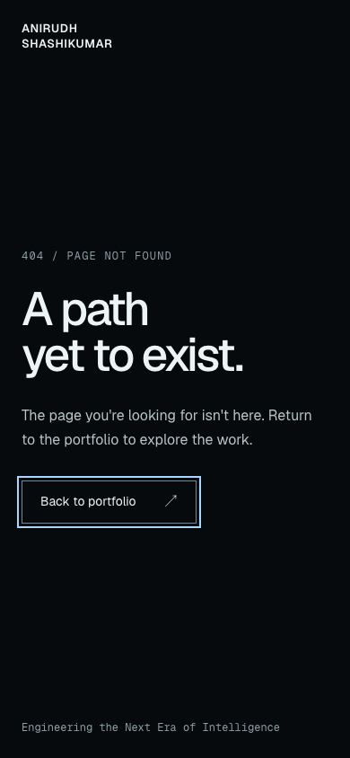

# SEO and browser branding remediation

**Date:** 26 October 2026. **Target:** Next.js 16.4.3 webpack production build. **Starting revision:** `77eee63`.

This implements the requested SEO, icon, sharing and error-page foundation, addressing the scope of F06 and F13 in the [production audit](PORTFOLIO_PRODUCTION_AUDIT.md). The [F01](DEPENDENCY_SECURITY_REMEDIATION.md), [F02](ACCESSIBILITY_F02_REMEDIATION.md), [F03/F04](F03_F04_REMEDIATION.md) and [F05](F05_ACCESSIBILITY_POLISH.md) corrections are preserved. No commit or deployment was performed by this agent.

## 1. Existing metadata audit

Before this change, the homepage emitted its existing title, description and viewport metadata. It had no canonical link, Open Graph or Twitter card metadata, icon links or Person JSON-LD. No robots or sitemap route was implemented. Unknown paths already returned HTTP 404 with the framework's generic error page and inherited homepage title/description.

The repository had no explicit production origin in its README, deployment configuration, metadata or environment examples. A GitHub repository URL is not evidence of a deployed canonical origin. Baselines: [rendered metadata](qa/seo-branding/before/seo-results.json), [generic 404](qa/seo-branding/before/404.png), [Git state](qa/seo-branding/before/git-status.txt) and [source hashes](qa/seo-branding/before/source-hashes.json).

## 2. Asset inventory

- The existing identity is the full name in Geist/Geist Mono, near-black surfaces, off-white type and restrained cool-gray/blue accents.
- `public/` contained project screenshots, event/certificate imagery and supporting project assets. None was an approved personal logo or personal portrait. No team photograph was repurposed as a Person image.
- `src/app/` contained only the root layout, homepage and global stylesheet. No favicon, touch icon, social image or custom error page existed.
- Existing Hero name treatment, fonts, project assets, section styles and motion sources were reused as visual references and left unchanged.

## 3. Approved branding decisions

The owner explicitly approved the displayed **plain Geist “A”** proposal for both icons: “Approve the proposed A icon.” It is a typographic initial using the existing family and palette, rather than an unapproved new geometric identity. The proposal includes actual 16/32px raster samples enlarged with nearest-neighbor scaling for inspection.


The social preview follows the requested full-name typography, supporting phrase and restrained intelligence-field direction. The 404 uses the existing fonts/palette, static composition and homepage navigation. Neither introduces a new animation system.

## 4. Generated assets

| Asset | Source/location | Properties | Local production response |
| --- | --- | --- | --- |
| Favicon | `src/app/favicon.ico` | ICO containing decoded 16×16, 32×32 and 48×48 PNG frames; 2,748 bytes | `/favicon.ico`: 200, `image/x-icon` |
| Apple touch icon | `public/apple-touch-icon.png` | 180×180 PNG; opaque RGB, no alpha channel; 4,998 bytes | `/apple-touch-icon.png`: 200, `image/png` |
| Social preview | `public/opengraph-image.png` | 1200×630 PNG; opaque RGB; 62,822 bytes | `/opengraph-image.png`: 200, `image/png` |

The Apple icon has a complete near-black background; platform corner masking does not expose unintended transparency. The small favicon samples retain a recognizable high-contrast initial. Main icon/preview type is `#edf4f6` on `#070a0c` (17.84:1).

[Offline generator](../scripts/generate-brand-assets.mjs) uses the already installed Next.js `ImageResponse`, bundled Geist Regular TTF and Sharp to generate the checked-in raster assets. The icon output is staged in `brand-proposal/`; its approved ICO and Apple PNG are copied to the locations above. There is no production image-generation endpoint, font download for the preview, new package, build-script change or runtime dependency on the generator. Re-rendering with a later Next version requires visual review of its bundled font/rendering behavior.

## 5. Canonical URL decision

The owner explicitly confirmed **<https://myportfolio-alpha-one-48.vercel.app/>**. [site.ts](../src/lib/site.ts) stores its normalized origin, with `homeUrl` supplying the homepage's trailing slash. No localhost, inferred preview deployment or unconfirmed custom domain is used.

The canonical link, Person URL/ID, sitemap location, robots sitemap reference and social-image URLs use that approved origin. Next normalizes the root `og:url` without a trailing slash; URL parsing confirms it denotes the same homepage as the canonical and sitemap.

A separate read-only request to the confirmed public origin returned 200 and the expected portfolio title/name. That deployed response still lacked the new canonical/social image, as expected before deployment. See [remote response summary](qa/seo-branding/after/production-origin-summary.json) and [HTTP result](qa/seo-branding/after/production-origin-readonly.txt). Local verification is not represented as an already deployed change.

Keeping canonical and sitemap URLs consistent follows [Google's canonical guidance](https://developers.google.com/search/docs/crawling-indexing/consolidate-duplicate-urls). This is a canonical preference signal, not an indexing or ranking guarantee.

## 6. Metadata implementation

- [Root layout](../src/app/layout.tsx): owner-confirmed `metadataBase`, original title/description, title template, explicit 180×180 Apple icon metadata. Next's root `favicon.ico` file convention supplies the favicon link.
- [Homepage](../src/app/page.tsx): self-canonical; `website` Open Graph type, name, URL, title, description, static image dimensions/type/alt; Twitter `summary_large_image`, title, description, image and alt. No invented account handle.
- Homepage-only canonical and social metadata prevent unknown routes inheriting a homepage canonical or advertising the homepage preview as their own.
- Existing `next/font` configuration and provider nesting are unchanged. The Person script is additional server-rendered data; the existing homepage sections remain in their original order.

The installed guides under `node_modules/next/dist/docs/` were read for metadata, icons, robots, sitemap, JSON-LD, ImageResponse and not-found conventions before coding. Server-rendered output is checked without JavaScript, including direct Twitterbot, Facebook crawler and Googlebot requests: all return 200 with canonical/OG/Twitter tags in the response head, not dependent on hydration.

## 7. Robots and sitemap validation

[robots.ts](../src/app/robots.ts) is a Next `MetadataRoute.Robots` export:

```text
User-Agent: *
Allow: /

Sitemap: https://myportfolio-alpha-one-48.vercel.app/sitemap.xml
```

[sitemap.ts](../src/app/sitemap.ts) is a Next `MetadataRoute.Sitemap` export with **one URL: the actual public homepage**. Hero, Work, About, Contact and six project presentations are homepage sections, not separate indexable routes. There are no invented case-study pages, fragments, error pages, assets or arbitrary `lastModified` timestamps.

Both routes are statically generated. Local production responses are 200 with `text/plain` and `application/xml` respectively. The sitemap parses without XML errors and has the required sitemap namespace. Exact bodies and assertions are in [robots evidence](qa/seo-branding/after/robots.txt.txt), [sitemap evidence](qa/seo-branding/after/sitemap.xml.txt) and [SEO results](qa/seo-branding/after/seo-results.json). These rules allow the public portfolio; they do not override any hosting-level access or robots headers.

## 8. Structured-data validation

The homepage emits one native `application/ld+json` script containing a [Schema.org Person](https://schema.org/Person):

- `name`: Anirudh Shashikumar.
- `description`: the existing statement about building systems across AI, vision, software and the physical world.
- `url` and stable `@id`: the approved homepage and `/#person`.
- `sameAs`: the exact GitHub and LinkedIn URLs already used by the Contact section.

No employer, professional job title, completed degree, award, credential, portrait or Twitter profile was invented. `JSON.stringify` with `<` escaped as `\u003c` follows the installed Next JSON-LD guide's safe embedding pattern.

The browser suite parses the served JSON, checks the exact allowed field set/types/identity values, confirms a single Person script, compares the profile URLs to the actual Contact anchors and verifies its absence on 404 pages. These are local syntax/content/schema-vocabulary checks; no external rich-results submission, Google eligibility certification or ranking benefit is claimed.

## 9. Social-preview inspection


The name occupies two strong lines inside a generous safe margin. Supporting text uses the requested exact phrase. Faint architectural axes, concentric field geometry and a few restrained nodes carry the existing technical motif without stock imagery, code illustrations, neon or animation. The raster was inspected at its native 1200×630 dimensions and at a smaller sharing-card scale. Main identity and supporting phrase remain readable; peripheral small labels are supplementary.

The same absolute PNG URL serves Open Graph and Twitter metadata. HTTP MIME, dimensions, opacity and alt metadata are checked from the production server. Platform-specific preview caching/cropping will still need a real post-deployment check; no external preview simulator result is implied.

## 10. 404 behavior

[not-found.tsx](../src/app/not-found.tsx) and [scoped CSS](../src/app/NotFound.module.css) add a static branded server-rendered page: visible full name, clear “404 / Page not found,” brief explanation and two ordinary homepage links. Scoped styles preserve the homepage design. There is no new client component or animation system.

Ten browser scenarios cover Chrome and WebKit at desktop, 390px phone, 360px no-JavaScript phone, no-JavaScript reduced-motion desktop and 430px reduced-motion phone. Unknown nested paths return **real HTTP 404**. Next supplies `noindex`; the page has its own title/description and no homepage canonical, OG metadata or Person script. Native Enter navigation follows the rendered homepage anchor with and without JavaScript.

Tab traversal (Option+Tab for macOS WebKit's link traversal) exposes visible 2px focus outlines. The return link exceeds 44px height. Every checked width has zero horizontal overflow. New readable text ratios against `#070a0c` are **17.84:1** (off-white), **11.23:1** (explanation) and **7.23:1** (secondary text). The link border is **5.47:1**. Six JavaScript-enabled scoped WCAG A/AA/2.1 AA axe runs report zero violations; no-JavaScript checks separately confirm rendered navigation and layout. See [contrast calculations](qa/seo-branding/after/404-contrast.json) and [browser evidence](qa/seo-branding/after/seo-results.json).



The browser console records the expected document 404 for these deliberately missing URLs. That status is intentional, not a failed homepage asset.

## 11. Regression results

| Check | Result |
| --- | --- |
| `npx eslint src/` | Pass |
| `npx tsc --noEmit` | Pass |
| `npm run build:webpack` | Pass; homepage, not-found, robots and sitemap prerendered |
| `git diff --check` | Pass |
| Existing About content tests | 4/4 pass, including complete production no-JavaScript biography |
| Existing About motion suite | Pass; 20 holds, 76 boundary samples, 65 viewport samples, reading/focus, reduced/reverse/input cases |
| Existing ScrollDiscovery suite | 7 viewport cases and 25 behavior cases pass |
| Existing F02 accessibility suite | 7 cases pass: real keyboard/AX traversal, all six projects, Work reading, Contact, reduced motion and no-JavaScript baselines |
| Existing F03/F04 suite | 7 cases pass; MediFit certificate/status and footer contrast/layout preserved |
| Existing F05 inspection | 319 Hero samples over 11 viewport sizes: no horizontal text clips or document overflow; 20 Dayflow labels across 16 states/320 node samples retain minimum 0.75 opacity; reading/reduced scans have zero violations |
| Existing decorative Contact checks | Cinematic, reduced and no-JavaScript modes pass; decorative monument preserved and meaningful full-name heading/links available |
| Existing production Chrome matrix | 8 sizes, 802 sampled states; zero page errors, failed requests, loaded-but-broken images, horizontal overflows, horizontal text candidates or active scrub mismatches |
| Existing production WebKit matrix | 3 sizes, 318 sampled states; same zero-error/overflow/mismatch result |
| Existing targeted production audit | 5 viewport sizes, 16 scoped scans complete; raw violation rule/target lists match the F05 baseline |
| Existing extra production audit | All six project reverse signatures match; WebGL fallback resolves; WebKit direct Work/About/Contact anchors and reader/reduced states pass |
| Existing isolated scroll-input trials | Hero + six projects + About + Contact: all 9 regions pass slow, fast and reverse input, 108 observed states |
| New SEO/branding suite | 19 cases pass: server/crawler metadata, identity data, five endpoint/assets and ten browser 404 scenarios |

Chrome matrix sizes: **360×800, 390×844, 430×932, 768×1024, 1280×720, 1280×800, 1440×900, 1728×1117**. WebKit sizes: **390×844, 1280×720, 1440×900**. The Hero inspection additionally covers 391px, 600px and 767px intermediate widths. Browser automation uses actual installed Chrome 155.0.8059.85 and WebKit 26.5 on macOS arm64, through an external Playwright installation; it adds no repository dependencies. Phone results are emulation, not a physical-device certification.

Across the 1,120 matrix samples, measured scroll positions, document heights, trigger counts and About cinematic/editorial modes match the F05 baseline **without a recorded difference**. The new JSON-LD does not alter section geometry or timing. All six Work projects, their horizontal handoffs, About, Contact and ScrollDiscovery remain present. See [matrix comparison](qa/seo-branding/after/browser-comparison.json), [accessibility comparison](qa/seo-branding/after/accessibility-comparison.json), [production evidence](qa/seo-branding/after/production/), and individual suite logs/results under [after/](qa/seo-branding/after/).

Only **`src/app/layout.tsx` and `src/app/page.tsx`** changed among the 78 baseline source/dependency/configuration files; the other **76** hashes match. Added application files are `src/lib/site.ts`, `src/app/robots.ts`, `src/app/sitemap.ts`, `src/app/not-found.tsx`, `src/app/NotFound.module.css` and `src/app/favicon.ico`. Public assets, the offline generator, this report and isolated QA evidence are additional files. All existing section content, motion code, styles, dependencies, lockfile, framework/ESLint configuration and build scripts are preserved. Shared Git history was inspected and retained. See [preservation evidence](qa/seo-branding/after/source-preservation.json) and [isolated patch](qa/seo-branding/after/task.patch).

All **eleven emitted WOFF2 files match their original hashes**. The generated preview is a static raster and is not imported into the Hero or page's client graph. Aggregate emitted JavaScript changes from 24 chunks / **2,102,466 bytes** to 26 chunks / **2,108,536 bytes**: **+6,070 raw bytes**; summed per-file gzip estimates change from 611,670 to 614,566 bytes (**+2,896**). Seventeen chunks are byte-identical; changes concern the new not-found/Link references, generated route stubs and runtime manifest. These are all-build filesystem totals, not initial-download or network-transfer measurements. See [bundle comparison](qa/seo-branding/after/bundle-comparison.json) and [font comparison](qa/seo-branding/after/font-comparison.json). No loading, WebGL or scroll-performance improvement is claimed.

Known accessibility limitations are preserved explicitly: staged/reveal frames can still produce contrast candidates, decorative inactive Work rail numbers remain in raw scoped results, the decorative Contact outline warning remains in static modes, and layered graphics retain manual-review checks. The initial full-document and Work reading-mode scans have zero rule violations, which is not a whole-site conformance claim. No ARIA suppression or motion removal was added. Real VoiceOver/NVDA/JAWS acceptance and the previous F05 limitations remain outside this browser-only verification.

The final build and SEO suite were repeated after relying on Next's automatic 404 `noindex` rather than a redundant page-level declaration. No section, typography, asset, animation or accessibility implementation changed after the broad regression runs. The existing external-lockfile, Node module-type and Three.Clock deprecation notices remain unrelated; no page error or hydration failure was recorded in the checked application states.

**Implementation verdict:** the requested SEO/browser-branding foundation is complete in the tested local production build. The owner origin and icon decisions are resolved. Final public-deployment and platform-preview verification remain dependent on a separately authorized deployment.

## 12. Remaining deployment dependencies

1. Deploy only when explicitly authorized. This task does not deploy or commit. After deployment, repeat the five public endpoint checks, crawler head inspection, unknown-path 404 and profile/sitemap/canonical consistency against the approved HTTPS origin.
2. Inspect actual Twitter/X/Open Graph rendering after platform caches refresh; submit the sitemap through the owner's search-console workflow if desired. No external account action was performed.
3. If a custom domain replaces the approved Vercel address, update `site.origin`, verify its TLS/redirect behavior and rerun URL/crawl assertions before publishing. Do not silently substitute `VERCEL_URL` or a preview hostname.
4. Hosting-level authentication, `X-Robots-Tag` or platform robots restrictions must be checked on the final deployment; local application metadata cannot override them.
5. Existing unrelated audit items remain subject to their own owner/release decisions: placeholder case-study actions, claim evidence, public-original image metadata and graphics/performance follow-up. F05's documented transitional contrast/manual-review findings and real assistive-technology acceptance remain; this SEO task is not a full WCAG or unrestricted release certification.
